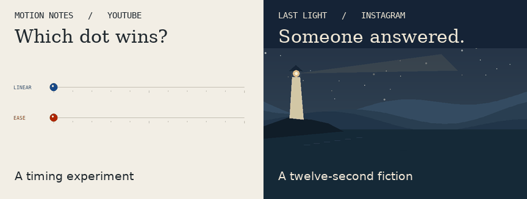

# Creator Runbook

**Give your coding agent a camera roll. Get a first cut back.**

Creator Runbook teaches Codex, Claude Code, and other coding agents to turn an idea or your own footage into a playable video, with sound, captions, and copy for the channel. Describe the result in chat. The agent operates the edit.



**One dot. Two commissions.** For a design audience, two dots race to explain easing. For a fiction audience, a light across the water answers a lighthouse. Watch [the narrated experiment](https://raw.githubusercontent.com/maazbin/creator-runbook/main/examples/motion-notes/narrated.mp4) or [the wordless short](https://raw.githubusercontent.com/maazbin/creator-runbook/main/examples/last-light/video.mp4). Both run for 12 seconds. [Explore the source and both edits](examples/).

## Make your first cut

Paste this into your coding agent. It works as written with just the idea.

```text
Use the video skill at https://github.com/maazbin/creator-runbook.
Read skills/creator-runbook/SKILL.md and handle setup for me.
Make a six-second square animation: a dot takes a wrong turn in a maze,
backs up, and finds the exit. Give me the playable MP4 and Instagram caption.
```

For your own footage, replace the maze sentence with your brief and attach the files or give the agent access to their folder. To keep the skill across projects, ask your agent to install the `skills/creator-runbook` directory. It follows the [Agent Skills specification](https://agentskills.io/specification).

## Give it the kind of brief you actually have

| You say | What the agent edits around |
| --- | --- |
| “Use five seconds of me. Let my voice carry the demo.” | A short on-camera hook, a continuous voiceover over the actual result, and a return to you for the close. [See the edit recipe](skills/creator-runbook/references/presenter-short.md). |
| “I have an interview and forty minutes of footage.” | Timecoded selects, the speaker’s exact words, and a sequence built around what the footage establishes. [Documentary and long-form workflow](skills/creator-runbook/references/formats.md). |
| “Run this on my design channel and my fiction account.” | A different premise, framing, language and post for each audience. [Compare the two episode briefs](examples/). |

## Under the hood

The coding agent writes and directs the piece. The included renderer uses Python, Pillow, and FFmpeg to create the MP4 locally. It can use an installed narrator, your recorded audio, or an authorized voice provider. Your private footage and channel history live in your own working directory. Exporting video requires an agent host that can execute code or render media.

[Read the skill](skills/creator-runbook/SKILL.md) · [Production guide](skills/creator-runbook/references/production.md) · [Writing and research](skills/creator-runbook/references/research.md) · [MIT license](LICENSE)
