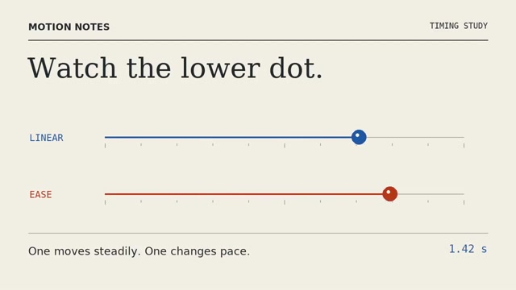
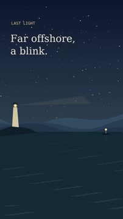

# Creator Runbook

Tell your coding agent what you want to make. Give it an idea, a folder of footage, or access to your assets. It writes the script, creates or edits the pictures, handles the sound, and returns the finished video and channel copy in the same chat.

> I have one glowing dot. For my design channel, use it to teach timing. For my fiction channel, make it a light someone has waited all night to see. Make both videos.

| Motion Notes · YouTube | Last Light · Instagram |
| --- | --- |
|  |  |
| [Play the timing experiment](https://raw.githubusercontent.com/maazbin/creator-runbook/main/examples/motion-notes/video.mp4) · [Post](examples/motion-notes/post.txt) · [Captions](examples/motion-notes/captions.srt) | [Play the animated story](https://raw.githubusercontent.com/maazbin/creator-runbook/main/examples/last-light/video.mp4) · [Post](examples/last-light/post.txt) · [Captions](examples/last-light/captions.srt) |

The [narrated version of the experiment](https://raw.githubusercontent.com/maazbin/creator-runbook/main/examples/motion-notes/narrated.mp4) uses an installed system voice.

Both cuts are twelve seconds. One uses a two-second race to make easing visible. The other uses a lighthouse, a delayed reply and an original bell motif. Each has its own composition, script, score, captions and post. The [animation source](examples/make_examples.py) and episode files reproduce both.

## Use it in your agent

Paste this into Codex, Claude Code or another coding agent with file access and execution:

> Use the creator-runbook skill from https://github.com/maazbin/creator-runbook. Read its SKILL.md and handle setup yourself. Make a 30-second vertical explainer from the clips I attached. Open with the failed attempt, use my recorded voice, and show the moment the fix works. Give me the playable cut, captions, and Instagram copy.

The agent can clone this repository and read the skill directly. To make it reusable across projects, ask the agent to install the `skills/creator-runbook` directory in its supported skill location. A host that reads Markdown can follow the same instructions. The package uses the open [Agent Skills format](https://agentskills.io/specification).

## What the creator can give it

| Starting point | What the agent does |
| --- | --- |
| A sentence or a sketch | Finds a filmable premise, checks factual claims and makes original diagrams, motion or a fictional scene. |
| Footage, an interview, a drive folder or a voice recording | Opens the accessible files, selects actual moments, preserves quotes, cuts to the performance and prepares captions. |
| Several accounts covering different niches | Remembers each audience privately, writes an angle for each account, and adapts the framing, language and post. |
| A documentary or longer essay | Builds a source ledger and chapter outline, times interview selects, renders sequences and reviews continuity before delivery. |

The creator works in chat. Rendering uses headless media capabilities on the agent's machine. The included renderer uses Python, FFmpeg and Pillow for drawn artwork. It runs locally, without a production-service account or a second model. Any voice clone, custom avatar or private footage comes from creator-authorized assets or an available authorized provider. A text-only chat can write and direct a piece; exporting an MP4 requires execution or a rendering tool.

[Read the skill](skills/creator-runbook/SKILL.md) · [See the writing repairs](skills/creator-runbook/references/script-desk.md) · [See the research](skills/creator-runbook/references/research.md) · [Inspect the production workflow](skills/creator-runbook/references/production.md)
