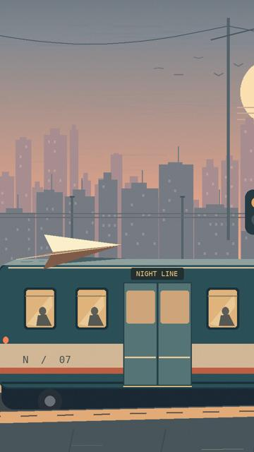

# Last Train

> A paper plane misses the last train.

[Watch the original 15-second film](film.mp4). It was drawn and scored for this seven-word brief. No footage, fonts, or voice from the creator's private launch are bundled here.

## Cut to the action

| Film time | What changes | How the shot makes it readable |
| --- | --- | --- |
| 0:00–0:03.75 | A paper passenger approaches an open door. | A wide view establishes the gap and direction of travel. Warm light spills onto the platform. |
| 0:03.75–0:06.35 | The door shuts ahead of the nose. | The cut moves in on the door. Its light vanishes on the latch sound. |
| 0:06.35–0:10.60 | The departure pulls the nose down and lifts the paper. | The lower camera keeps the folded wing readable against the moving carriage. Foreground benches move faster than the skyline. |
| 0:10.60–0:15 | The passenger lands on the last roof. | The paper and its shadow meet. Car and passenger travel together as the station continues past them. |

## Reproduce the shot

From a checkout containing this example, the agent runs `python examples/last-train/animate.py last-train.mp4` with Pillow and FFmpeg available. The output is 1080×1920, 30 fps with an original station bell, latch, slipstream and landing motif. The [consistency document](consistency.md) records the framing, light, palette, type and editorial cues. The [animation source](animate.py) uses the skill's [motion tracks](../../skills/creator-runbook/scripts/motion.py) and its [lit paper model](../../skills/creator-runbook/scripts/fold.py).
